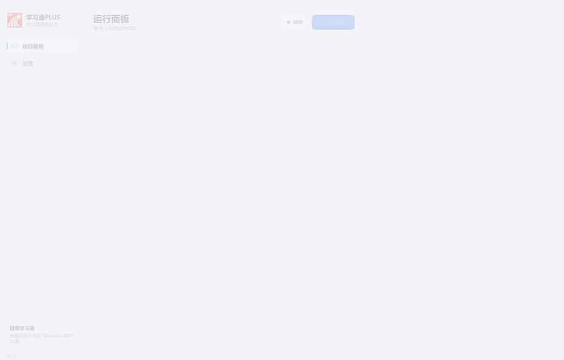
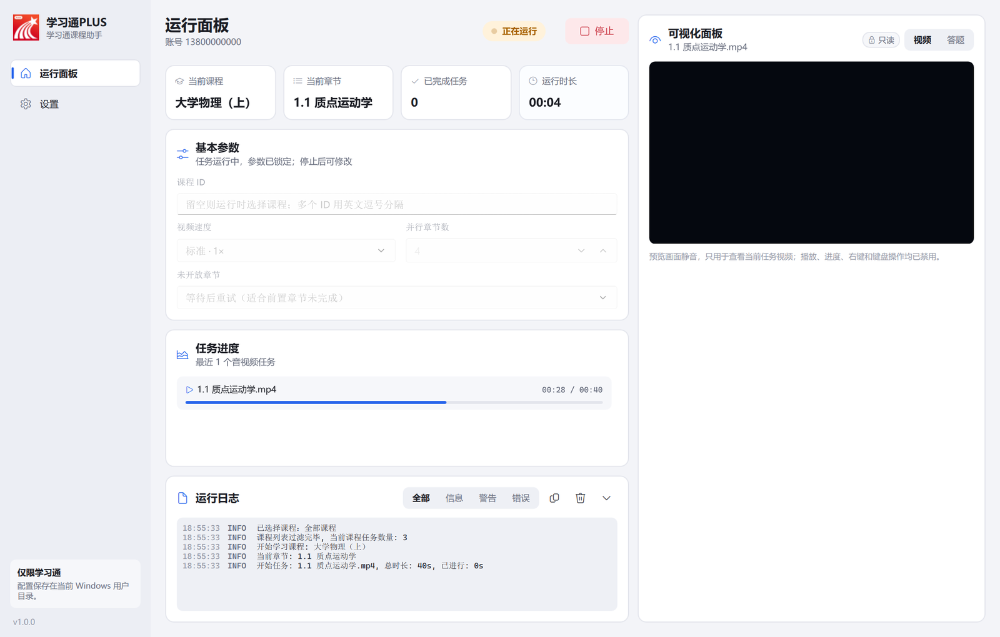
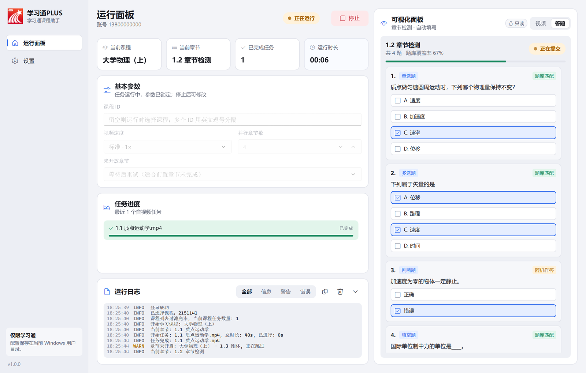
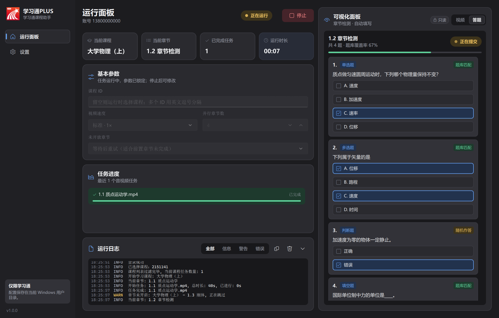
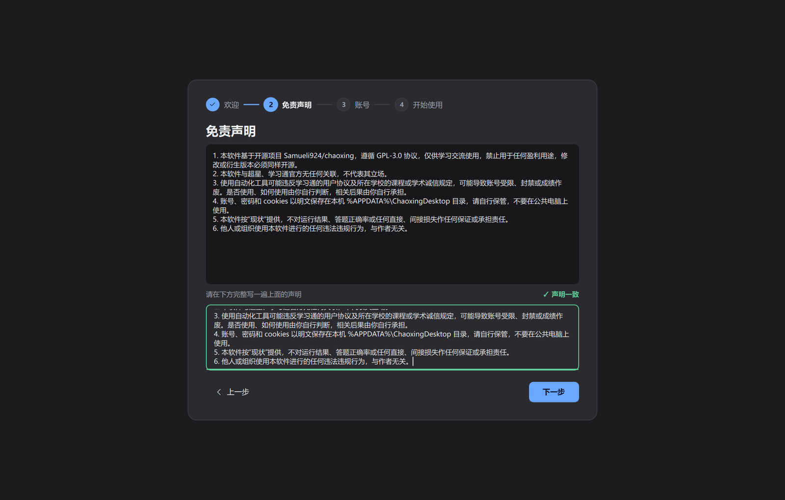
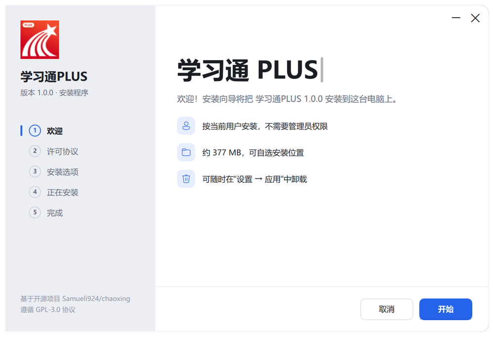
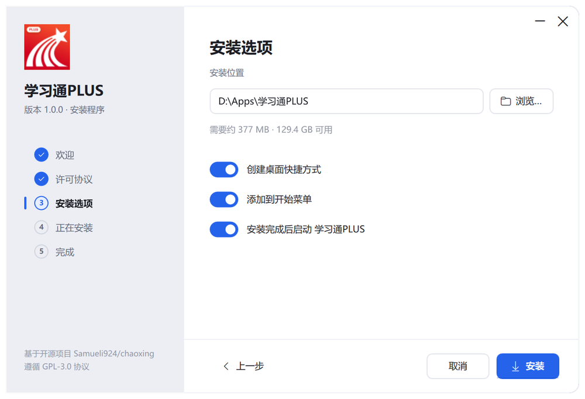

<p align="center">
  
</p>

<h1 align="center">学习通PLUS</h1>

<p align="center">
  超星学习通桌面客户端 · 基于开源项目 <a href="https://github.com/Samueli924/chaoxing">Samueli924/chaoxing</a>
  <br>
  
  
  
</p>

<p align="center">
  
</p>

---

## 一、软件介绍

学习通PLUS 把原本的命令行工具做成了一个 Windows 桌面应用：图形化配置、实时查看运行状态，不用再在终端里输入参数。

<p align="center">
  
</p>

> 截图和动图使用模拟数据录制，不对应任何真实账号或课程。视频预览区域在录制中显示为黑色，是因为系统视频控件无法被截取，实际使用时会显示当前课程视频。

### 主要特性

- **运行面板**：左侧是仪表盘（当前课程、章节、已完成任务、运行时长）、基本参数、音视频任务进度和可筛选的运行日志。
- **只读可视化面板**：右侧实时显示当前任务的视频（静音、不可操作），以及章节检测的题目和填写的答案（标注题库匹配 / 随机作答、覆盖率和提交状态），界面只用于查看。
- **课程选择**：不填写课程 ID 时，运行后会弹出课程列表供勾选。
- **Fluent 风格界面**：浅色 / 深色 / 跟随系统，全程动画过渡。
- **启动画面**：程序在后台加载配置和界面，加载完成后进入主窗口。
- **首次启动引导**：欢迎 → 免责声明 → 账号 → 开始使用；账号可以稍后再配置。
- **自制安装程序**：按当前用户安装，不需要管理员权限，支持升级和卸载。
- **本地保存**：配置、cookies 和日志只保存在本机 `%APPDATA%\ChaoxingDesktop`。

### 截图

| 运行面板 · 视频 | 运行面板 · 答题 |
| --- | --- |
|  |  |

| 深色模式 | 首次启动引导 |
| --- | --- |
|  |  |

| 安装程序 · 欢迎 | 安装程序 · 选项 |
| --- | --- |
|  |  |

---

## 二、如何使用

### 1. 安装

1. 在 [Releases](../../releases) 下载 `学习通PLUS-Setup-<版本>.exe`。
2. 双击运行，按向导完成安装：接受许可协议 → 选择安装位置和快捷方式 → 安装。
   - 默认安装到 `%LOCALAPPDATA%\Programs\学习通PLUS`，不需要管理员权限。
   - 已安装旧版本时再次运行会直接升级，配置不受影响。
3. 视频预览需要 Microsoft Edge WebView2 运行时（Windows 11 已自带）。

也可以下载 `学习通PLUS-Windows.zip` 免安装使用：解压后运行 `学习通PLUS.exe`，保持 `chaoxing-worker.exe` 和 `_internal` 文件夹在同一目录。

### 2. 首次启动

第一次打开会进入开始引导：

1. **欢迎**：了解主要功能。
2. **免责声明**：阅读声明，并在输入框中完整写一遍，内容一致后才能继续。
3. **账号**：填写学习通账号和密码，或开启 cookies 登录（把 `cookies.txt` 放入配置目录）。暂时不想填可以点“稍后配置”，之后在 **设置 → 账号** 中填写；没配置前运行面板顶部会一直提醒。
4. **开始使用**：进入运行面板。

### 3. 运行任务

1. 在运行面板左侧的 **基本参数** 里设置课程 ID（留空则运行时选择）、视频速度、并行章节数和未开放章节的处理方式。
2. 点击 **开始运行**。参数会自动保存，运行期间锁定。
3. 在左侧查看进度和日志，在右侧可视化面板查看当前视频或章节检测内容。
4. 需要时点击 **停止**。

其他选项（重试间隔、章节学习次数、外观）在 **设置** 页。题库等高级配置仍在配置目录的 `config.ini` 中，说明见 [docs/CLI.md](docs/CLI.md)。

### 4. 卸载

在 Windows **设置 → 应用** 中找到 学习通PLUS 卸载，或运行安装目录中的 `学习通PLUS.exe --uninstall`。卸载时可以选择是否同时删除配置、cookies 和日志（默认保留）。

### 从源码构建

需要 Windows 10/11 x64 和 PowerShell：

```powershell
pwsh -NoProfile -ExecutionPolicy Bypass -File .\build_windows.ps1
```

脚本会准备便携 Python 和依赖，生成：

- `dist\学习通PLUS\`：免安装程序目录
- `dist\学习通PLUS-Windows.zip`：免安装压缩包
- `dist\学习通PLUS-Setup-<版本>.exe`：安装程序

开发者说明见 [CLAUDE.md](CLAUDE.md)，命令行用法见 [docs/CLI.md](docs/CLI.md)。

---

## 三、关于原仓库

学习通PLUS 基于 [**Samueli924/chaoxing**](https://github.com/Samueli924/chaoxing)（超星学习通自动化完成任务点，命令行版）开发。任务处理、登录、题库对接等核心逻辑均来自原仓库及其贡献者；本项目在此基础上增加了桌面界面、可视化面板、安装程序等。

- 原仓库地址：<https://github.com/Samueli924/chaoxing>
- 原仓库贡献者：<https://github.com/Samueli924/chaoxing/graphs/contributors>
- 命令行版使用说明（来自原仓库）：[docs/CLI.md](docs/CLI.md)

感谢原作者和所有贡献者的开源工作。

### 许可与免责声明

- 本项目与原仓库一样遵循 [GPL-3.0](LICENSE) 协议：允许开源 / 免费使用、引用、修改和衍生；衍生版本必须同样以 GPL-3.0 开源；**禁止将本项目或其衍生版本作为闭源商业软件发布或销售，禁止用于盈利**。
- 本软件与超星、学习通官方无任何关联。程序图标以学习通官方图标为底图制作，相关商标归其权利人所有。
- 使用自动化工具可能违反学习通用户协议及学校的课程或学术诚信规定，可能导致账号受限、封禁或成绩作废，相关后果由使用者自行承担。
- 本代码仅用于学习讨论，他人或组织使用本代码进行的任何违法违规行为与作者无关。
